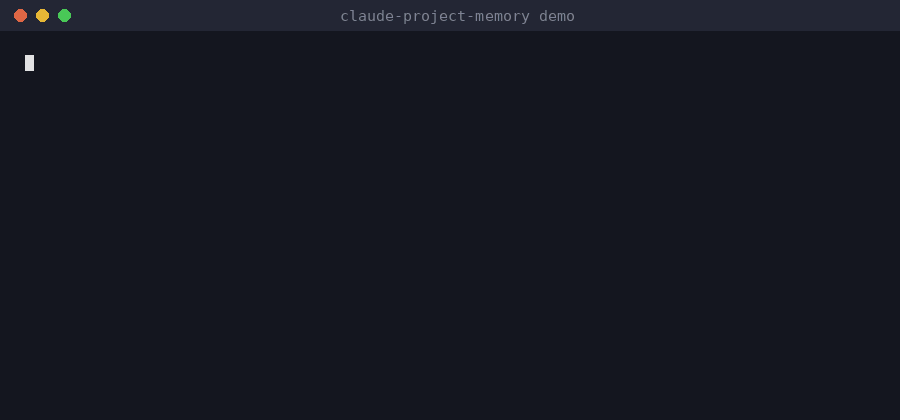

# claude-project-memory

[](https://github.com/swittchen/claude-project-memory/actions/workflows/test.yml)
[](LICENSE)


**Persistent project memory for [Claude Code](https://docs.claude.com/en/docs/claude-code/overview).**
Start a new session in your project folder — Claude already knows the goal, where you stopped and what to do next.

[Русская версия → README.ru.md](README.ru.md)



---

## The problem

Claude Code forgets everything between sessions. In long sessions it compacts the conversation and loses details. Over many small steps it drifts away from the original goal. And on a big project (a large codebase, a book) it is easy to burn your usage limit just by reading files.

## What claude-project-memory does

| Problem | Solution |
|---|---|
| Forgets between sessions | Goal, state and plan live in plain Markdown files in `ai/` and load automatically at every start |
| Loses things on compaction | A hook forces a checkpoint (`/save`) when work stays unsaved too long; the full transcript is backed up before compaction |
| Drifts from the goal | The goal file is locked for Claude; every message carries a one-line "goal / milestone / task" anchor; every task must name the criterion it moves |
| Burns tokens on big projects | Start costs ~3–6k tokens regardless of project size; Claude reads through a map and an index, never the whole project |
| Knowledge gets lost | A separate knowledge base following [Karpathy's LLM Wiki](https://gist.github.com/karpathy/442a6bf555914893e9891c11519de94f) pattern: `raw/` sources → LLM-maintained `wiki/` |
| Commits behind your back | Claude may not `git add/commit/push`; it suggests a commit message, you commit |

Works for **new and existing** projects: software (tested on a Spring Boot repo) and long texts such as books. Templates in **English and Russian**.

## Why not just CLAUDE.md or auto-memory?

- **CLAUDE.md** holds rules, not progress. Nobody keeps it updated after every task, so after a few sessions it no longer says where you are. Here `/save` rewrites `ai/STATE.md` and `ai/PLAN.md` at every checkpoint, and a hook refuses to finish while they lag behind.
- **Auto-memory** decides on its own what to remember and stores it outside the repo. Here the memory is plain Markdown in your project, versioned with git, readable and editable by you — and the goal file is locked so Claude cannot quietly move the target.
- **Compaction** summarises and forgets. Here the important state is already on disk before it happens, and the full transcript is backed up.

## Quick start

```bash
# 1. Get it (once)
git clone https://github.com/swittchen/claude-project-memory.git ~/tools/claude-project-memory
echo "alias project-memory='bash ~/tools/claude-project-memory/install.sh'" >> ~/.bashrc && source ~/.bashrc

# 2. Add it to a project (new or existing — nothing of yours is overwritten)
project-memory ~/projects/my-project            # English template
project-memory ~/projects/my-project --lang ru  # Russian template

# 3. First session
cd ~/projects/my-project && git init         # if it is not a git repo yet
claude                                       # accept the "trust this folder" dialog!
/kickoff                                     # short interview → goal, criteria, plan
```
Then freeze the goal: `mv ai/GOAL.draft.md ai/GOAL.md && chmod a-w ai/GOAL.md`, and commit.

## Daily loop

```
claude          → Claude: "goal / where we are / next step"
(one task from ai/PLAN.md)
/save           → memory files updated, commit message suggested
git commit      → you
/clear          → fresh context, next task
```
One task per session is both the most reliable and the cheapest way to work.

## Commands

| Command | When |
|---|---|
| `/kickoff` | first session of a project |
| `/save` | after a task, before a big task, at the end of a session |
| `/breakdown` | split a milestone (or a too-big task) into one-session tasks |
| `/check` | run the verification of each done-criterion and record evidence |
| `/ingest ai/raw/<file>` | turn a source document into wiki pages (runs in a separate context) |
| `/query <question>` | answer from the wiki with links; good answers are filed back |
| `/lint` | weekly wiki clean-up (mechanical part done by a script, 0 tokens) |
| `/drift` | every few sessions: how much work went off-goal? |

## What gets installed

```
your-project/
├── CLAUDE.md             your rules + 4 import lines (created or appended)
├── .claude/
│   ├── settings.json     locks, hooks, auto-memory off, earlier compaction (merged with yours)
│   ├── hooks/            session-start · goal-anchor · stop-check · backup-transcript
│   ├── scripts/          wiki-lint.sh
│   └── skills/           /kickoff /save /breakdown /check /ingest /query /lint /drift
└── ai/                   the project's memory
    ├── RULES.md          how Claude works across sessions
    ├── GOAL.md           goal + verifiable criteria   ← always loaded, locked
    ├── STATE.md          where we are (≤ 60 lines)    ← always loaded
    ├── PLAN.md           milestones + tasks (≤ 40)    ← always loaded
    ├── MAP.md            map of modules / chapters
    ├── DECISIONS.md      decision log
    ├── LOG.md            session log
    ├── BACKLOG.md        deferred ideas
    ├── wiki/  raw/       knowledge base
    └── sessions/         transcript backups (git-ignored)
```

## The hooks in one sentence each

- **session-start** — at start and after compaction: tail of the log, last commits, uncommitted files, "previous session was interrupted" warning.
- **goal-anchor** — before every message: one line with goal, milestone and task (~30 tokens).
- **stop-check** — when Claude wants to finish: if work stayed unsaved for 40+ minutes or 15+ files changed, it must `/save` first.
- **backup-transcript** — before compaction: copies the full transcript to `ai/sessions/`.

## Requirements

- Claude Code
- git, bash (Linux/macOS; on Windows use Git Bash or WSL)
- python 3 — only for merging into an existing `.claude/settings.json`

## Tested

`bash tests/smoke.sh` — 38 checks of the installer and every hook, both languages, no tokens needed (also runs in CI).
Manually verified in Claude Code 2.1.310 on Linux: auto-loading, anchor, skills, blocked edits of the goal (`Edit`, `echo >>`, `mv`, `cp`), blocked `git add/commit`, Stop hook forcing `/save`, compaction backup.

## Docs

- [Full manual (EN)](docs/MANUAL.en.md)
- [Полный мануал (RU)](docs/MANUAL.ru.md)

## Credits & license

Knowledge-base design after Andrej Karpathy's [LLM Wiki](https://gist.github.com/karpathy/442a6bf555914893e9891c11519de94f).
Not affiliated with Anthropic. MIT license — see [LICENSE](LICENSE).
